# 8 сезон

Материал может содержать неточности и ошибки, а также быть субъективным, поскольку отражает восприятие автора. Если вы хотите внести какие-либо правки, пожалуйста, обратитесь в дискорд канал 📝[<mark style="color:$warning;">«Обращения»</mark>](https://discord.com/channels/956981761802375228/1245232823510503428).

## Продолжительность

Сезон официально стартовал <mark style="color:blue;">28 января 2026 года</mark> в 19:00 по московскому времени. Завершился он <mark style="color:blue;">9 июля 2026 года</mark> — из-за усталости игроков и ожидания следующего обновления игры. Игрокам с ролью [«Ягода» ](../o-proekte/vasha-podderzhka/rol-yagoda.md)предоставили возможность перенести свои недостроенные масштабные проекты в новый сезон.

## История

Восьмой сезон запомнился высокой интенсивностью патчей, ребалансом ключевых игровых механик, расширением границ мира и большим количеством новых уникальных кастомных зачарований.

Администрация объявила о старте сезона и о возвращении старого плагина на вагонетки <mark style="color:blue;">28 января 2026 года</mark>. Но стоило игрокам начать выживание, как в общем чате появилось неожиданное сообщение: «Все порталы в Край уничтожены!» Эта новость озадачила игроков, и они стали ждать нового масштабного интерактива от администрации. Параллельно искатели приключений занялись поиском наград за прошлый аукцион — сундуки с секретными лотами были закопаны по всему Верхнему и Нижнему миру. Однако при поисках заслуженных наград разными игроками также были обнаружены манекены игрока <mark style="color:$tint;">**\_Foxya\_**</mark>.

<figure><figcaption>
<em>Сохранившееся изображение манекена</em>
</figcaption></figure>

Как выяснилось, администрация полностью сломала порталы в Край и спрятала единственный рабочий проход в Незере, оставив игрокам лишь скриншот-подсказку. Не все спешили разгадывать эту загадку, но нашлись те, кто загорелся идеей поиска, хотя данных было критически мало. По скриншоту удалось понять лишь то, что комната находится в биоме багрового леса, в одном из типов пещер, которые генерируются чуть ниже бедрокового потолка Незера. Учитывая, что границы Незера составляли 5000x5000 блоков, поиски вручную могли бы затянуться на недели.

<figure>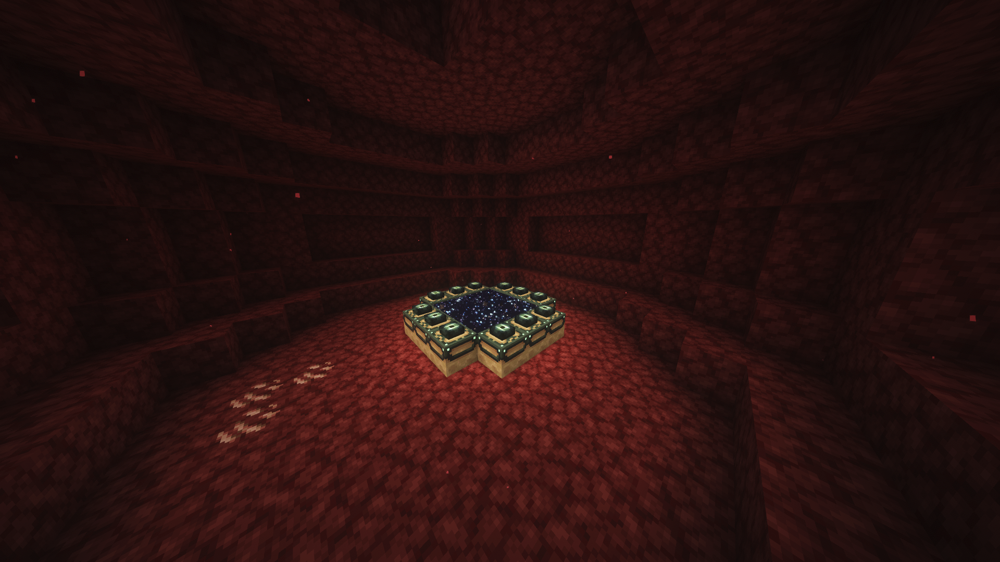<figcaption>
<em>Подсказка, опубликованная <mark style="color:$primary;"><strong>_Foxya_</strong></mark></em>
</figcaption></figure>

Спустя несколько дней, 2 февраля 2026 года, администратор <mark style="color:$tint;">**\_Foxya\_**</mark> выдал в чат единственную математическую координатную подсказку: «......-X////////////////////////////+Z/////////////////////////////////////////<2000». Благодаря бдительности, логике и упорству игроков <mark style="color:$primary;">**I\_valentain\_I**</mark> и <mark style="color:$primary;">**\_KOTIK\_B\_CAXAPE\_**</mark> портал нашли всего через несколько часов после её публикации. Искатели облагородили и красиво оформили портальную комнату, после чего администрация анонсировала скорое открытие Края.

<figure>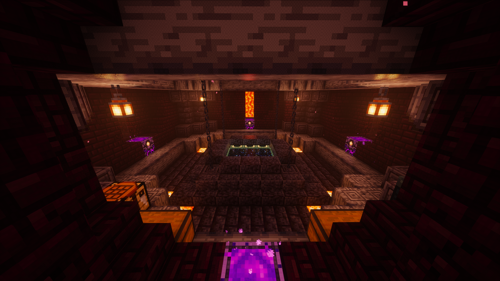<figcaption>
<em>Оформленная портальная комната</em>
</figcaption></figure>

Открытие Края состоялось <mark style="color:blue;">3 февраля 2026 года</mark> в 18:30 и стало самым быстрым открытием этого измерения за всю историю DreamFox.

Для удобного изменения ландшафта и защиты карты от неэстетичных выкопанных ям, <mark style="color:blue;">16 февраля 2026 года</mark> на сервере появились кастомные крафты земли, дёрна и подзола.

Также <mark style="color:blue;">22 февраля 2026 года</mark> в камнерезе добавили новые крафты, значительно упростившие обработку древесины, чему строители были очень рады.

В течение первой трети сезона сервер подвергался серии мощных DDoS-атак, из-за чего средний пинг игроков сильно повышался. Администрация написала специальный плагин, который автоматически включал сохранение инвентаря при смерти, как только фиксировался критический скачок пинга. Однако через некоторое время плагин пришлось полностью убрать: некоторые недобросовестные игроки начали откровенно злоупотреблять внезапной безнаказанностью. В итоге <mark style="color:blue;">1 марта 2026 года</mark> сохранение инвентаря было окончательно отключено.

Весь сезон за серверный ресурс-пак отвечал игрок <mark style="color:$tint;">**ElizarovS**</mark>: он взялся за него основательно и по собственной инициативе, без устали развивая и наполняя пак день за днём. За это время он добавил огромное количество кастомных трёхмерных моделей и текстур для предметов, получаемых через механику переименования (часть из них он с нуля создал сам), а также занялся визуальным оформлением кастомных предметов и артефактов сервера, сделав их облик уникальным. Первое масштабное обновление пака вышло <mark style="color:blue;">1 марта</mark>, а финальная версия — <mark style="color:blue;">3 июля</mark>.

<figure>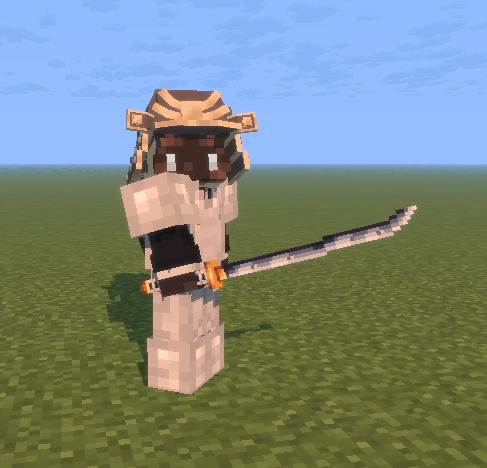<figcaption>
<em><mark style="color:$tint;"><strong>ElizarovS</strong></mark> с катаной и шлемом кабуто</em>
</figcaption></figure>

В начале сезона обустройством и терраформингом спавна в добровольном порядке занялся игрок <mark style="color:$tint;">**Unissy\_Trye**</mark>, провозгласивший себя его главой. Он разделил спавн на три ключевые зоны: общую территорию, Верхний спавн (основная торговая зона с магазинами) и Нижний спавн (зона декоративных построек). <mark style="color:$tint;">**Unissy\_Trye**</mark> успел отстроить пристань и набережную, после объявил конкурс на лучшее судно. Однако <mark style="color:blue;">9 марта 2026 года</mark> из-за разногласий с ожиданиями игроков он официально сложил с себя полномочия.

<figure>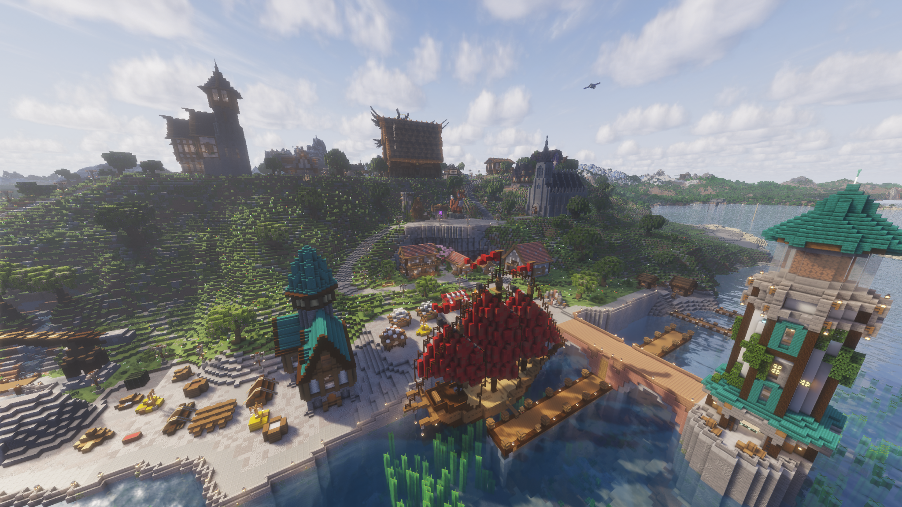<figcaption>
<em>Вид на пристань</em>
</figcaption></figure>

<figure>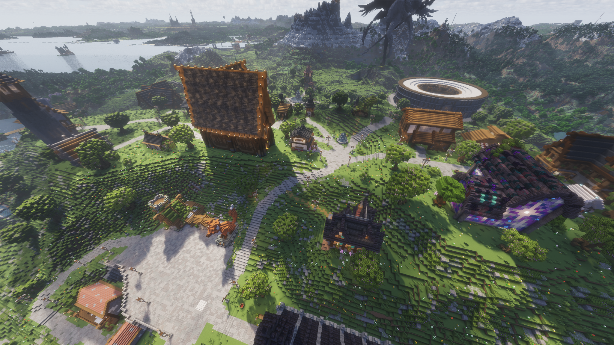<figcaption>
<em>Верхняя часть спавна</em>
</figcaption></figure>

По результатам голосования игроков <mark style="color:blue;">19 марта 2026 года</mark> управление спавном перешло к Совету Спавна, в который первоначально вошли <mark style="color:$tint;">**Vzxtrot,**</mark> <mark style="color:$tint;">**\_\_MrSam\_\_**</mark> и <mark style="color:$tint;">**ElizarovS**</mark>. Позже на смену <mark style="color:$tint;">**\_\_MrSam\_\_**</mark> полномочия взял на себя <mark style="color:$tint;">**I\_valentain\_I**</mark>. \
\
Под руководством обновлённого Совета на спавне провели масштабную реставрацию и озеленение: возвели здание Совета спавна, значительно улучшили и оживили порт, построили канализацию, тюрьму, арену, подземные катакомбы, галерею, уютный парк, сцену и ристалище. После, <mark style="color:blue;">24 апреля 2026 года</mark>, правила спавна официально зафиксировали и вывесили под статуей лисы. Они строго запрещали ПВП, разбрасывание мусора и любые несогласованные изменения спавна.

К сожалению, постройка хаба в этом сезоне превратилась в настоящую катастрофу из-за отсутствия постоянного ответственного лица. \
Первоначальную и кратковременную инициативу взял на себя игрок <mark style="color:$tint;">**baron\_elfanguece**</mark>, но по-настоящему стройкой занимались <mark style="color:$tint;">**zefirushka12**</mark> и <mark style="color:$tint;">**Deskrine\_Zet\_X**</mark>. Из-за затянувшегося процесса, не самого удачного концепта и постоянных споров в чате о том, кто отвечает за хаб, достроить его так и не удалось. Тем не менее визуально хаб выглядел приятно, а ледяные дороги были проложены достаточно далеко.

<figure>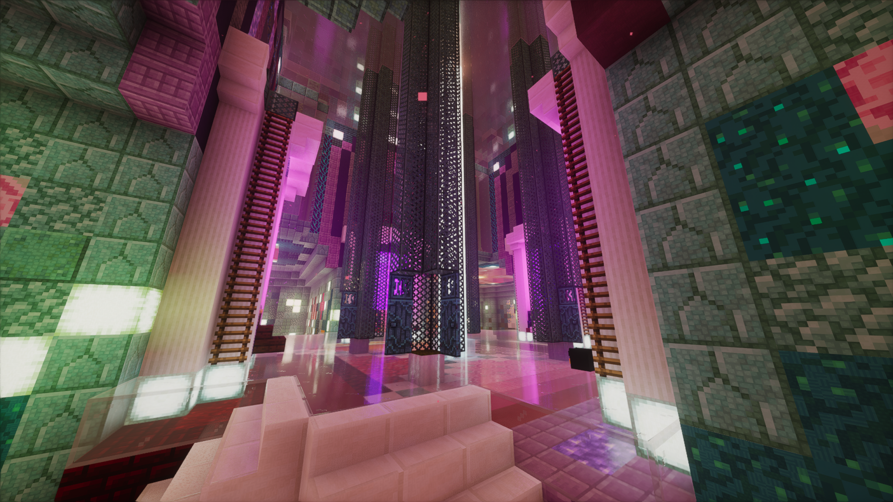<figcaption>
<em>Пересечение дорог</em>
</figcaption></figure>

<figure>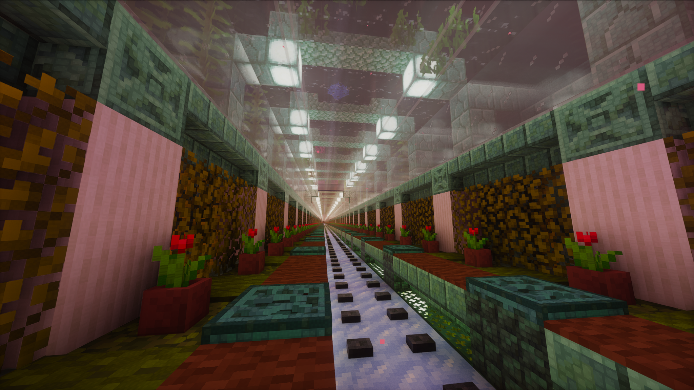<figcaption>
<em>Дизайн дороги изнутри</em>
</figcaption></figure>

В игровой процесс сервера были внесены изменения <mark style="color:blue;">24 марта 2026 года</mark>: добавлены кастомные камеры и мониторы, уникальное зачарование «[Вуаль пустоты](../o-proekte/osobennosti/unikalnye-zacharovaniya.md#vual-pustoty)», крафт ниток из белой шерсти и получение чёрного красителя путём переплавки каменного угля.

Для удобства игроков и оптимизации складского хранения на сервере запустили функцию обратного [раскрафта блоков](../o-proekte/krafty/raskraft.md). Игроки смогли разбирать на исходные компоненты такие блоки, как: аметист, натёчный камень, восковой блок, магма, светокамень, кирпичи и кварц.

<mark style="color:blue;">В конце</mark> <mark style="color:blue;">марта</mark> на сервере прошёл ребаланс основных рас, в ходе которого существенно ослабили дварфов и их гибридную версию — кобольдов. Причиной таких жёстких мер стал недавний на тот момент тестовый апгрейд, в ходе которого эффект спешки шахтёров подняли с 2 до 10 уровня. Сверхскоростная добыча буквально сломала серверную экономику: участники сервера, выбравшие данные расы для игры, в кратчайшие сроки заполнили рынок алмазами, опустошили полки магазинов и создали искусственный дефицит товаров.

<figure>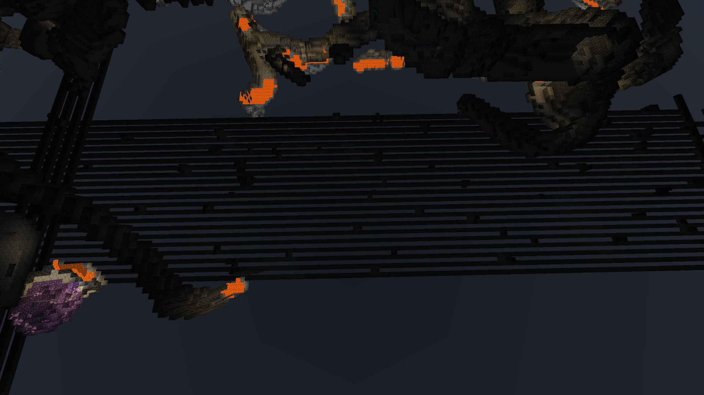<figcaption>
<em>Шахты, прорытые дварфом всего за 15 минут</em>
</figcaption></figure>

В рамках «Лисо-фикса» <mark style="color:blue;">29 марта 2026 года</mark> на сервер добавили долгожданный [портативный сундук Края](../o-proekte/krafty/portativnyi-sunduk-kraya.md), а также ввели механику [создания бутылочек опыта](../o-proekte/krafty/butylochki-opyta.md).\

<figure>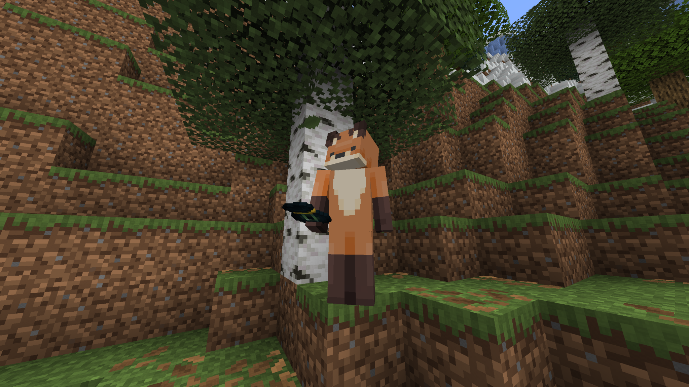<figcaption>
<em>Игрок, держащий в руке портативный сундук Края</em>
</figcaption></figure>

Второй месяц весны порадовал сервер особым праздником: <mark style="color:blue;">1 апреля 2026 года</mark> сообщество торжественно отпраздновало 4-летие DreamFox!\

Через несколько дней на сервере появилась механика записи кастомных звуков на козьи рога, по аналогии с [музыкальными пластинками](../o-proekte/osobennosti/kastomnaya-muzyka.md).

<mark style="color:blue;">В конце апреля</mark> в медном куполе на спавне прошёл экстренный аукцион вещей забаненных игроков и артефактов[^1]. Администратор также предложил игрокам обменять 10 артефактов на один мощнейший. В итоге этот самый сильный артефакт получила <mark style="color:$tint;">**Uwka**</mark>.

Изначальная граница Верхнего мира составляла 5000x5000 блоков. Чтобы открыть для игроков новые неизведанные территории для застройки и поиска ресурсов, администрация расширила её до 6000x6000 блоков <mark style="color:blue;">30 апреля 2026 года</mark>.

В начале мая игру добавили 5 новых кастомных зачарований: [«Листопад»](../o-proekte/osobennosti/unikalnye-zacharovaniya.md#listopad), [«Отпор»](../o-proekte/osobennosti/unikalnye-zacharovaniya.md#otpor), [«Стрела Края»](../o-proekte/osobennosti/unikalnye-zacharovaniya.md#strela-kraya), [«Человечность»](../o-proekte/osobennosti/unikalnye-zacharovaniya.md#chelovechnost) и [«XXX»](../o-proekte/osobennosti/unikalnye-zacharovaniya.md#xxx).\

\
В то же время на сервер вернулись метеориты, застав игроков врасплох. Механика их падения полностью повторяла седьмой сезон: космические тела с нарастающим гулом обрушивались рядом со случайными игроками, оставляя глубокие кратеры, уничтожая постройки в эпицентре и порождая редкие ресурсы. Вместе с метеоритами вернулся и крафт метеоритоотвода, спрос на который резко вырос. А уже <mark style="color:blue;">5 мая 2026 года</mark> был создан [ОБРОМ (отряд быстрого реагирования по делам о метеоритах)](8-sezon.md#obrom-otryad-bystrogo-reagirovaniya-po-delam-o-meteoritakh).

<figure>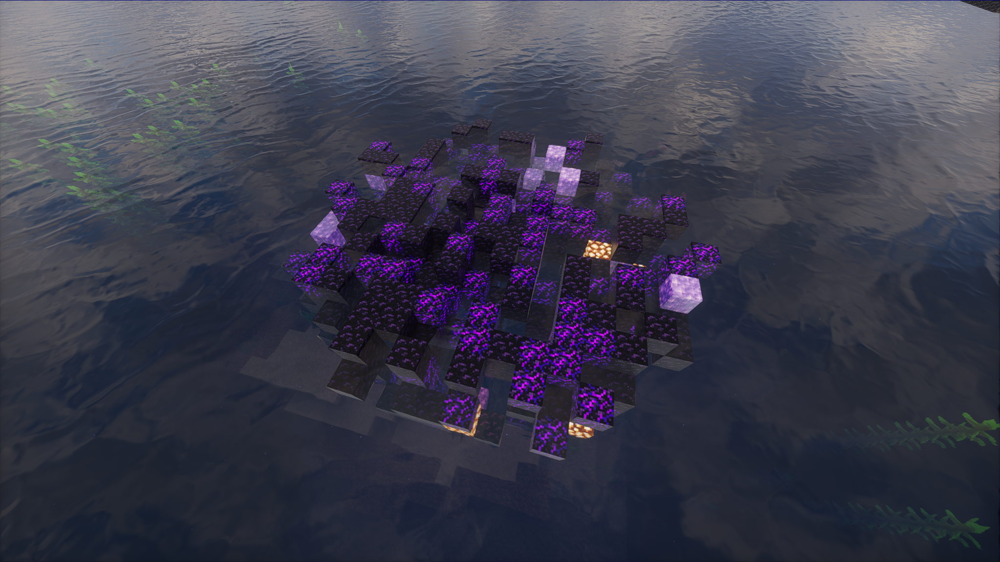<figcaption>
<em>Место падения обсидианового метеорита</em>
</figcaption></figure>

<figure>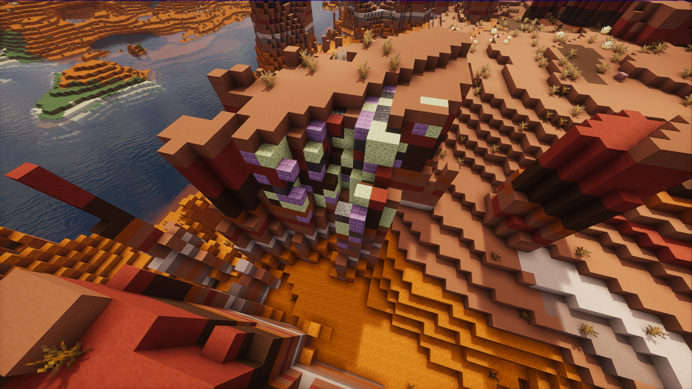<figcaption>
<em>Оставшееся от метеорита Края в месе</em>
</figcaption></figure>

На одном из тропических островов администрация возвела казино, которое стало ещё одним необычным местом восьмого сезона. На протяжении всего сезона игроков приглашали посетить заведение и испытать удачу в многочисленных игровых автоматах. Каждый желающий мог попытать удачи, проведя время за различными азартными развлечениями. Казино не раз напоминало о себе, а интерес к нему сохранялся вплоть до конца сезона. По слухам, постоянный поток посетителей и их игра принесли администрации весьма внушительное состояние.

<figure>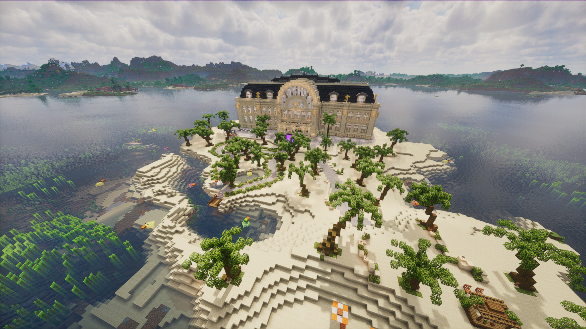<figcaption>
<em>Вид на песчаный пляж и казино</em>
</figcaption></figure>

Во второй половине мая, а именно <mark style="color:blue;">19 мая 2026 года</mark>, администратор <mark style="color:$tint;">**\_Foxya\_**</mark> представил кастомный инструмент — [ростомерку](../o-proekte/krafty/rostomerka.md), доступную игрокам с ролью  [«Ягода» ](../o-proekte/vasha-podderzhka/rol-yagoda.md). С её помощью можно изменять размеры мобов и некоторых сущностей.

В скором времени сервере появилась новая партия кастомных зачарований: [«Баллистика»](../o-proekte/osobennosti/unikalnye-zacharovaniya.md#ballistika), [«Картечь»](../o-proekte/osobennosti/unikalnye-zacharovaniya.md#kartech), [«Слаймость»](../o-proekte/osobennosti/unikalnye-zacharovaniya.md#slaimost), [«Плавление»](../o-proekte/osobennosti/unikalnye-zacharovaniya.md#plavlenie), [«Поступь ткача»](../o-proekte/osobennosti/unikalnye-zacharovaniya.md#postup-tkacha) и [«Восходящий поток»](#user-content-fn-2)[^2].&#x20;

<mark style="color:blue;">В конце мая</mark> по итогам всеобщего голосования сообщества администрация разрешила [крюку-хватателю](../o-proekte/krafty/kryuk-khvatatel.md), появившемуся ещё в седьмом сезоне, захватывать мобов. Забавный предмет превратился в по-настоящему полезный инструмент для строителей и фермеров, заметно упростив транспортировку существ.

<figure>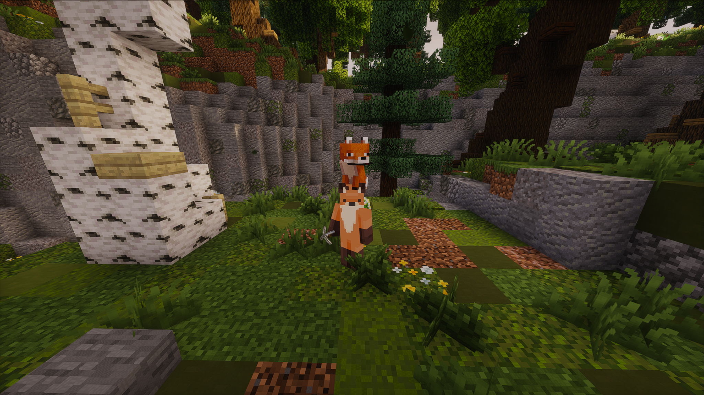<figcaption>
<em>Как моб отображается на игроке после использования крюка</em>
</figcaption></figure>

Чуть позже, <mark style="color:blue;">3 июля 2026 года</mark>, администрация приняла решение убрать зачарование [«Восходящий поток»](#user-content-fn-2)[^2] из-за крайне низкой популярности и заметной нагрузки на сервер. В тот же день добавили настольную игру «Русская рулетка» и [крафт револьвера](../o-proekte/osobennosti/nastolnye-igry.md#russkaya-ruletka) для неё.

Отдельным удачным нововведением сезона стало добавление четырёх новых уникальных [гибридов рас](../o-proekte/osobennosti/rasy.md#gibridy): [сергал](../o-proekte/osobennosti/rasy.md#sergal), [скалковый шипохвост](../o-proekte/osobennosti/rasy.md#skalkovyi-shipokhvost), [адская гончая](../o-proekte/osobennosti/rasy.md#adskaya-gonchaya) и [негроб](../o-proekte/osobennosti/rasy.md#negrob). Все их характеристики были настроены самими игроками и приняты администрацией проекта.

## Города

### Империя Энрин (燕麟帝国)

Величественное и эстетичное восточное государство, основанное посреди океана на удалённом острове. По замыслу основателей — игроков <mark style="color:$tint;">**I\_valentain\_I**</mark> и <mark style="color:$tint;">**PURRCHIN**</mark> — мощь империи измерялась спокойствием, непоколебимостью и верностью традициям. Строительство масштабного замка, портовых причалов и садов с цветущей сакурой завершилось <mark style="color:blue;">24 марта 2026 года</mark> при активной поддержке <mark style="color:$tint;">**KALEO0023, Jodaell\_, \_KOTIK\_B\_CAXAPE\_, ElizarovS**</mark> и <mark style="color:$tint;">**\_\_MrSam\_\_**</mark>. Каждый из них внёс вклад в возведение построек или добычу ресурсов для проекта.

<figure>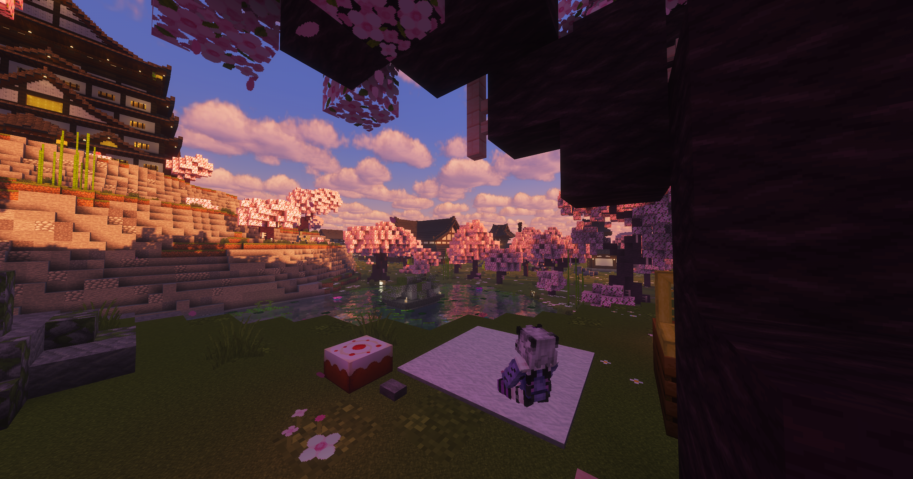<figcaption>
<em>Вид на замок, пруд «Великого аксолотля» и пикник игрока <mark style="color:$tint;"><strong>PURRCHIN</strong></mark></em>
</figcaption></figure>

<figure>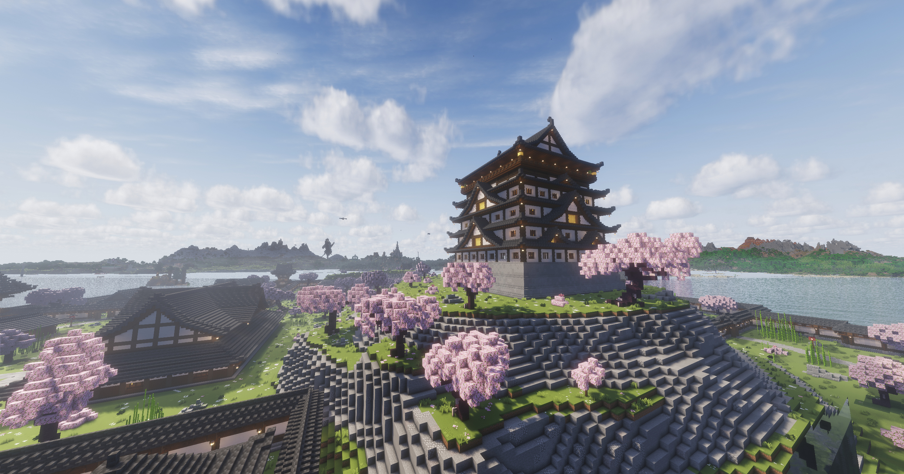<figcaption>
<em>Замок, сакуры и додзё</em>
</figcaption></figure>

Возле храма империи открыли аутентичный домик для получения предсказаний омикудзи (за пожертвование в один алмаз). На всей территории Энрин действовал строгий свод правил, запрещавший причинять вред живым существам.

<figure>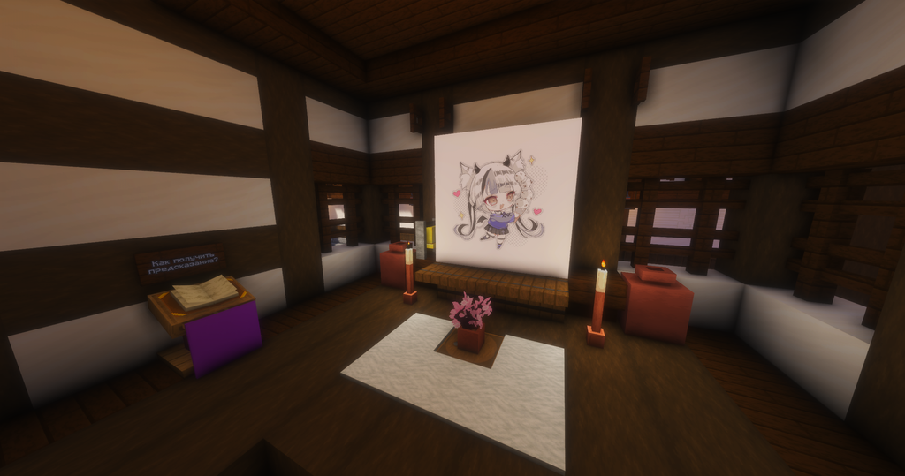<figcaption>
<em>Алтарь с предсказаниями</em>
</figcaption></figure>

### Город на Горе: ШаньДу (Shān Dū / 山萠)

Живописное восточное поселение в фэнтезийно-азиатском стиле, основанное <mark style="color:blue;">31 января 2026 года</mark> игроком <mark style="color:$tint;">**Creator\_MoD\_**</mark>. Город раскинулся на вершине величайшей вишнёвой горы сервера и предлагал жителям и редким путникам уединение, покой дикой природы и завораживающие горные пейзажи, утопающие в розовом цвету.

Активные участники города: <mark style="color:$tint;">**Creator\_MoD\_, vatyaoo, I\_Toshi\_I, Akae\_05**</mark>.

<figure>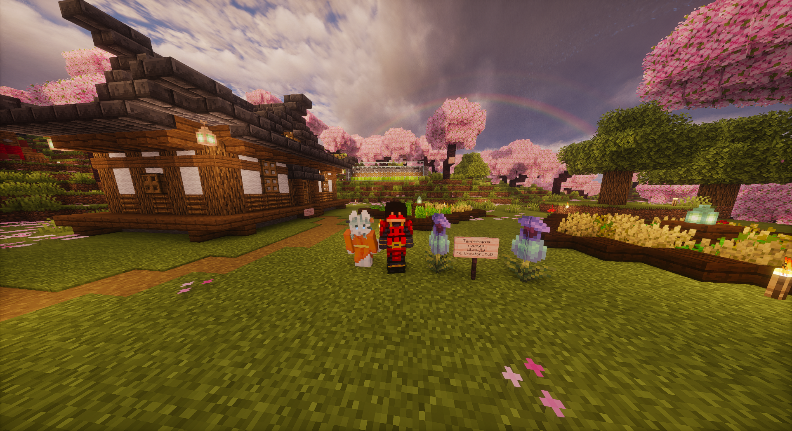<figcaption>
<em>Снимок <mark style="color:$tint;"><strong>Creator_MoD_</strong></mark> и <mark style="color:$tint;"><strong>vatyaoo</strong></mark></em>
</figcaption></figure>

Согласно истории города, <mark style="color:$tint;">**Creator\_MoD\_**</mark> был благородным самураем, который после долгих лет изнурительных сражений решил навсегда оставить кровопролитие. Пройдя трудный путь, он набрёл на тихую, скрытую туманами вишнёвую рощу, где обрёл душевное равновесие и построил скромную хижину. Здесь самурай подружился с необычным обитателем горы — белым песцом, который жил в глубокой норе и заваривал уникальный лисий чай с волшебными свойствами. Защита этой магической рощи стала делом чести самурая, а поселение постепенно разрослось вокруг его уединённого жилища.

<figure>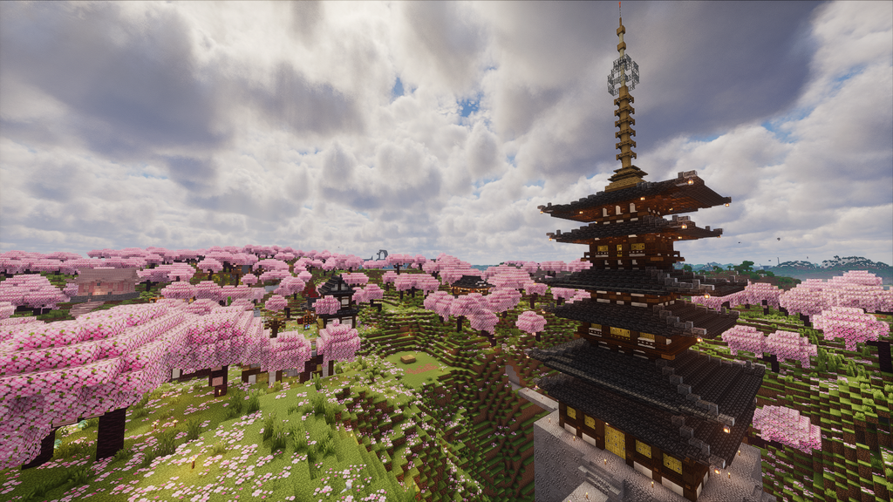<figcaption>
<em>Величественная башня</em>
</figcaption></figure>

<figure>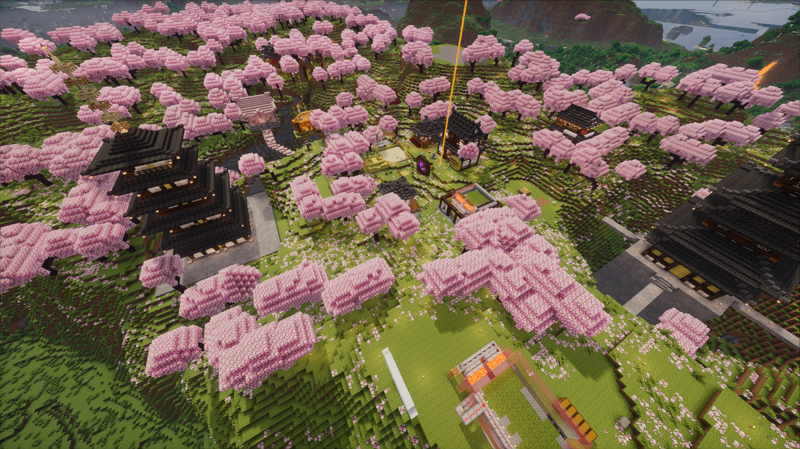<figcaption>
<em>Вид на город сверху</em>
</figcaption></figure>

<mark style="color:blue;">В мае 2026 года</mark> в поселение прибыл странствующий учёный <mark style="color:$tint;">**I\_Toshi\_I**</mark>, изучавший древние легенды, алхимию и тайные знания о реинкарнации сознания. Самурай гостеприимно предоставил коллеге одну из жилых палаток, однако Тоши, одержимый исследованиями, отказывался от сна и еды и круглосуточно изучал старинные манускрипты в поисках зацепок.

К дискуссиям о природе бытия присоединилась пробегавшая мимо vatyaoo. Она подсказала искателям, что мифическое существо кицунэ — не просто сказка, а осязаемый символ вечной трансформации духа, скрытый в символах древних текстов. Эти слова вдохновили <mark style="color:$tint;">**I\_Toshi\_I**</mark> продолжить эксперименты, несмотря на то что время было его главным врагом, а тело требовало отдыха.

После долгих дней непрерывных вычислений, споров за чаем и опасных ментальных практик прямо в палатках ШаньДу <mark style="color:$tint;">**I\_Toshi\_I**</mark> удалось нащупать истину. Когда <mark style="color:$tint;">**Creator\_MoD\_**</mark> в очередной раз вернулся в лагерь, вместо уставшего человека он обнаружил <mark style="color:$tint;">**I\_Toshi\_I**</mark>, успешно сменившего физическую оболочку и переродившегося в мудрое бессмертное мифическое существо — кицунэ.

<figure>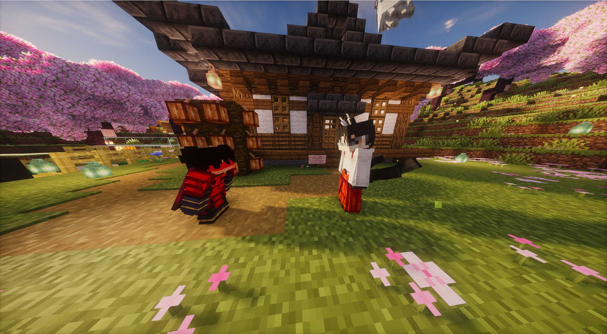<figcaption>
<em>Завершённое превращение в кицунэ</em>
</figcaption></figure>

### Империя Мандорра

На 8 сезоне Мандорра совершила грандиозный эволюционный скачок: из республики она превратилась в централизованную Империю с новым административно-территориальным делением на губернии (Волынская, Подольская и несколько Свободных губерний). Главным девизом государства на этот период стал лозунг: «Сохранить существующее и построить новое».

<figure><figcaption>
Подготовка территории к строительству
</figcaption></figure>

Император <mark style="color:$tint;">**Shaxta**</mark> инициировал глобальную реструктуризацию и объявил о трёх этапах реформ:

• I этап — Антикризисный. Удержание текущего состава, привлечение свежих сил и стабилизация внутренних процессов после кадровых потерь (в начале сезона фракцию покинули три человека).\
• II этап — Конституционный. Чёткое разделение ветвей власти, которое планировалось реализовать по мере расширения государственного штата.\
• III этап — Мотивационный. Внедрение продвинутой системы поощрений, льгот и стимулов для граждан империи.

<figure><figcaption>
Собрание игроков Мандорры
</figcaption></figure>

Для эффективного освоения территорий император лично провёл кадровые назначения и распределил зоны ответственности:&#x20;

• <mark style="color:$tint;">**Shaxta**</mark> — император. Общее руководство, проектирование архитектурного облика Санкт-Петербурга и развитие дорожной сети Империи. \
• <mark style="color:$tint;">**I\_Toshi\_I**</mark> — масштабное терраформирование столицы, изменение ландшафта и руководство ключевыми этапами застройки.\
• <mark style="color:$tint;">**ForgeEagle**</mark> — главный архитектор. Проектирование зданий для столицы в творческом мире, помощь императору и координация сбора строительных блоков.\
• <mark style="color:$tint;">**Jodaell\_**</mark> — Главный инженер по проектированию и возведению автоматических ферм.\
• <mark style="color:$tint;">**Medploh**</mark> — наместник Подольской губернии, ответственный за возведение и развитие подольских поселений и деревень.\
• <mark style="color:$tint;">**tsarikel**</mark> — интендант империи, ответственный за бесперебойное обеспечение государства ресурсами и помощь в хозяйственных мелочах.

<figure><figcaption>
Процесс строительства
</figcaption></figure>

Столицей государства стал величественный мегаполис Санкт-Петербург, возведённый силами империи на месте топких болот. Город строился как монументальный памятник имперскому стилю: с обилием светлого камня, тёмных крыш, гранитных набережных, мостов и строгим разделением секторов на жилую и промышленную застройку.

Силами игроков <mark style="color:$tint;">**Shaxta**</mark> и <mark style="color:$tint;">**I\_Toshi\_I**</mark> была проделана титаническая работа по изменению ландшафта. Огромные площади болот осушили и выровняли до нужной высоты, превратив их в «холст» для будущих кварталов. В кратчайшие сроки строители прорыли и облицевали камнем и булыжником две водные артерии: каналы Малой и Большой Невы, которые наполнились водой и разделили город на четыре обособленных сектора.

<mark style="color:blue;">В середине марта</mark> в самом центре столицы всего за один день построили здание Парламента — главный символ имперской власти. Его возвели по чертежам архитектора <mark style="color:$secondary;">**crimsonray\_**</mark> при активной помощи <mark style="color:$tint;">**ForgeEagle**</mark> и <mark style="color:$tint;">**I\_Toshi\_I**</mark> в сборе ресурсов и строительстве. Высочайшие шпили Парламента видны из любой точки города.

<figure>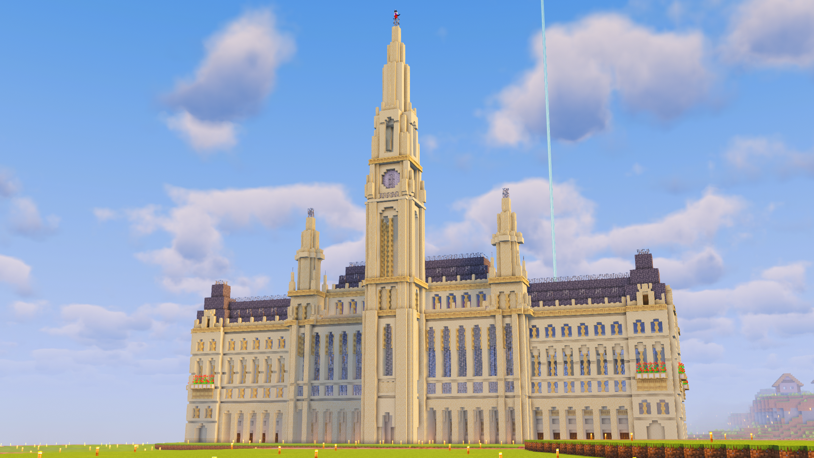<figcaption>
Завершенное здание парламента
</figcaption></figure>

После завершения базовой инфраструктуры в Санкт-Петербурге зажглись первые уличные фонари. В рамках первого этапа освещения, занявшего всего несколько часов, иллюминацией полностью обеспечили Центральный и Красногвардейский районы, сделав ночные улицы столицы безопасными и уютными. Параллельно инженеры восстанавливали утраченные мощности и строили новые технологичные автофермы для обеспечения рынка железом, шерстью и шалкерами.

<figure>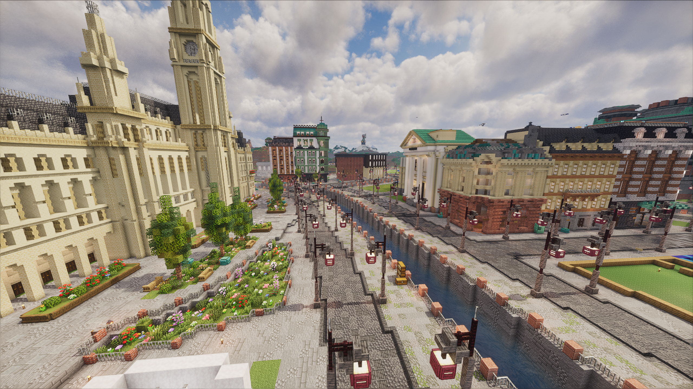<figcaption>
Вид на финальное состояние Империи
</figcaption></figure>

<mark style="color:blue;">В начале мая</mark>, 5 числа, в Центральном районе прогремел взрыв от падения крупного метеорита. Были сильно повреждены автомобильная дорога и каменная набережная Невы. Обошлось без пострадавших благодаря оперативным действиям имперских служб.

<figure><figcaption>
Метеорит упавший на Мандорру
</figcaption></figure>

Спустя 5 дней город пережил массированный космический удар: менее чем за 10 минут Смольный, Центральный и Адмиралтейский районы содрогнулись от падения сразу 5 метеоритов. Инфраструктуре угрожало полное уничтожение. Ликвидацией глубоких кратеров и экстренным ремонтом набережных лично занялась <mark style="color:$tint;">**SeivySeifie**</mark>, восстановив облик Санкт-Петербурга в кратчайшие сроки. [ОБРОМ](8-sezon.md#obrom-otryad-bystrogo-reagirovaniya-po-delam-o-meteoritakh) вручил руководству Мандорры метеоритоотводы, которые позволили обезопасить город от последующих ударов с небес.

<figure>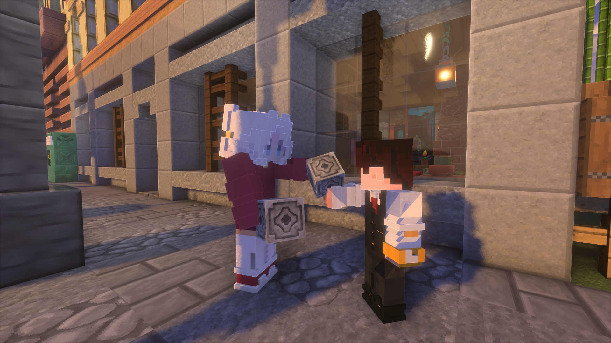<figcaption>
Представитель ОБРОМ <mark style="color:$tint;"><strong>SkyQu4ke</strong></mark> передает <mark style="color:$tint;"><strong>SeivySeifie</strong></mark> метеоритоотводы
</figcaption></figure>

## Гильдии

### Альянс «Пряники»

Большая часть его участников была администраторами проекта в другой игре, от названия которого произошло имя альянса. Альянс описывал себя как сообщество, объединённое дружбой, взаимопомощью и общей целью: каждый участник должен был вносить вклад как в развитие самого альянса, так и сервера в целом. «Пряники» подчёркивали, что готовы поддерживать друг друга в трудные моменты, и приглашали присоединяться игроков любых рас и характеров, чтобы вместе строить, копать, исследовать, тренироваться и развиваться. К концу седьмого сезона Пакт Свободных Городов (ПСГ) предложил «Пряникам» сотрудничество. Альянс называл это партнёрство важным шагом и благодарил ПСГ за доверие и поддержку. Официальным представителем и лидером альянса выступала <mark style="color:$tint;">**Prizrachel**</mark>.

<figure>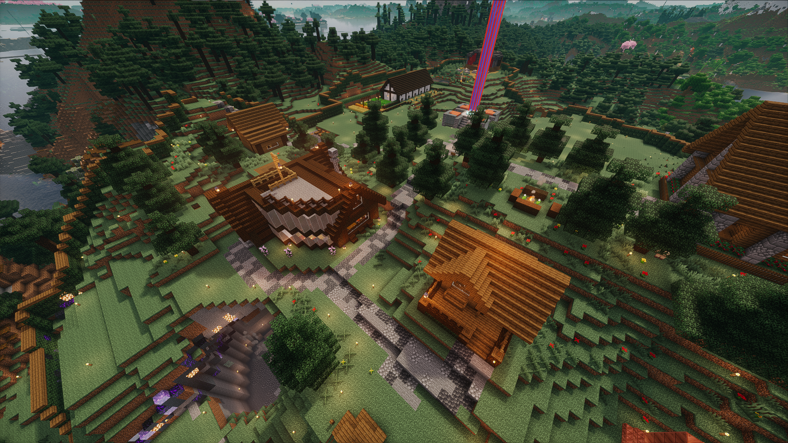<figcaption>
Территория Альясна
</figcaption></figure>

Официальный состав: <mark style="color:$tint;">**Prizrachel, Boberuk, yummi, Kapibarov, kit1213, Neyroset, KILL\_AND\_LIVE, Vesenka, amoga765780**</mark>.

### ПСГ (Пакт Свободных Городов)

Крупное объединение суверенных городов, появившееся в конце прошлого сезона. \
\
В начале 8 сезона Пакт продолжил активную деятельность и быстро привлёк внимание всего сервера. Члены союза занимались торговлей, проведением ивентов и созданием ламповой атмосферы. К сожалению, спустя некоторое время после старта сезона объединение перестало существовать из-за резкого спада активности части участников, внутренних разногласий и полной утраты первоначального смысла союза.

<figure>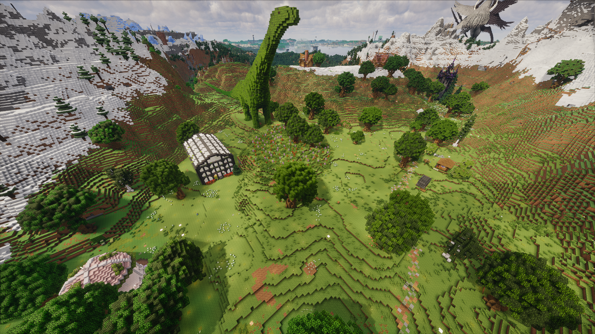<figcaption>
Территория нескольких участников ПСГ
</figcaption></figure>

### Культ Кувшина

В середине февраля позвучала животрепещущая новость: <mark style="color:blue;">12 февраля 2026 года</mark> основатель Культа <mark style="color:$tint;">**Opracus**</mark> и просветитель <mark style="color:$tint;">**Cultyapa**</mark> объявили, что организация уходит в подполье и получает статус тайной. \
Причиной стало обнаружение исследователями Культа загадочного древнего артефакта, который при контакте вызвал мощнейший выброс псионной энергии. Храм в джунглях и залы запечатали, а все исследования заморозили, чтобы не допустить раскола Кувшина.

### Общество Хранителей Знаний

Официальная научно-просветительская гильдия, основанная игроком <mark style="color:$tint;">**Cultyapa**</mark> <mark style="color:blue;">12 февраля 2026 года</mark>. Главной целью организации стали сбор, редактирование, оформление, распространение и архивирование рукописной информации со всего сервера, а также создание всеобъемлющей библиотеки имени Просто Фокси, знания в которой должны бережно переноситься из сезона в сезон. Внутренний кодекс гильдии строился на принципах: «Если каких-то знаний нет в книгах, то их можно записать! Если информацию нельзя записать, значит она бесполезна».

<figure>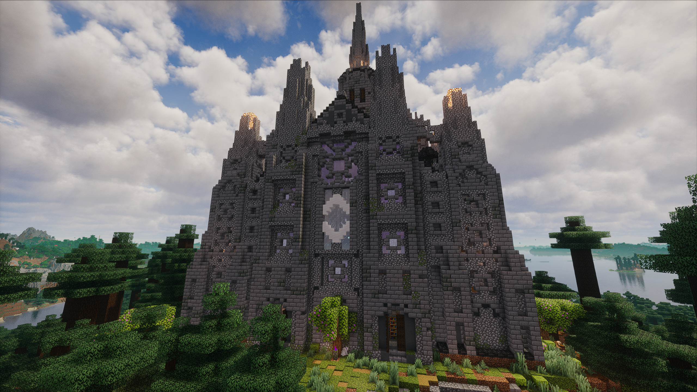<figcaption>
Библиотека снаружи
</figcaption></figure>

За рамками обычной архивации Общество выполняло функции секретного исследовательского центра, работающего с опасными и мистическими артефактами.

В день основания игрок <mark style="color:$tint;">**Darcnes45**</mark> сообщил Обществу, что в крепости «Предел» обнаружил таинственную древнюю книгу, которая манила окружающих запретной силой и «просила крови». На основе его наблюдений Хранители выяснили важную особенность: подавить аномальные свойства таких книг способна только медь, поэтому контактировать с ними можно лишь в медной броне.

<figure>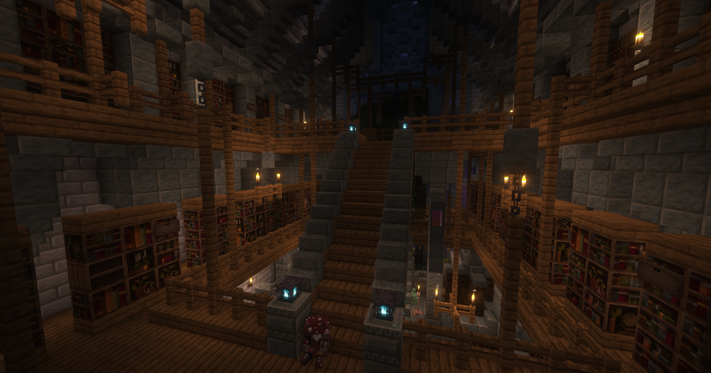<figcaption>
Библиотека изнутри
</figcaption></figure>

Позже, <mark style="color:blue;">7 марта 2026 года</mark>, в библиотеке оборудовали защищённое Хранилище магических артефактов, запертое на кодовый замок. Вход туда разрешался строго в медной спецзащите: нарушение герметичности костюма и контакт с артефактами грозили исследователям безумием или смертью.

<figure>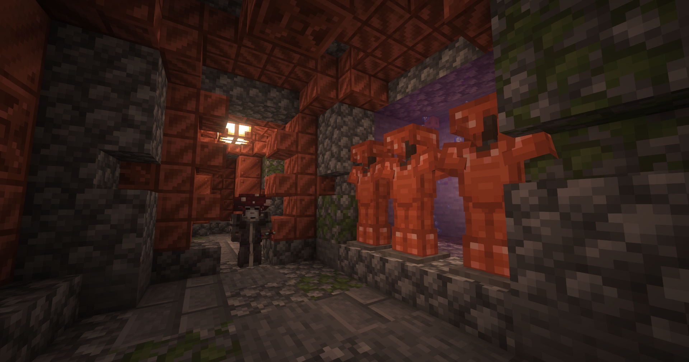<figcaption></figcaption></figure>

Общество было пополнено участниками <mark style="color:blue;">19 марта 2026 года</mark>: в ранг официальных Хранителей Знаний с правом ведения каталогов и управления библиотекой приняли игроков <mark style="color:$tint;">**\_Caiiko**</mark> и <mark style="color:$tint;">**lamEscuro**</mark>.

### ОБРОМ (Отряд Быстрого Реагирования по делам о метеоритах)

Высококвалифицированная научно-оборонная организация, созданная <mark style="color:blue;">5 мая 2026 года</mark> для защиты жителей от нескончаемых метеоритных падений. Бойцы отряда выезжали на места крушений, зачищали их, собирали внеземные ресурсы и бережно восстанавливали ландшафт и повреждённую инфраструктуру. Кроме того, они изучали закономерности падения космических тел и снабжали игроков защитными метеоритоотводами. Руководил отрядом <mark style="color:$tint;">**Kapibarov**</mark>.

<figure>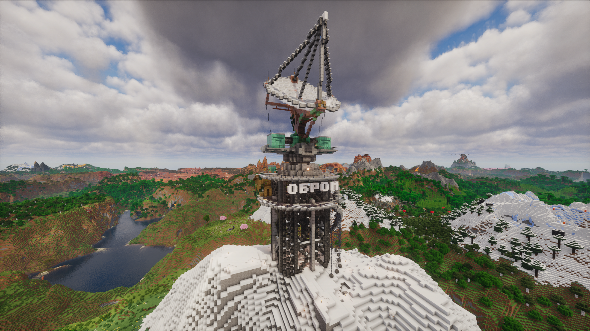<figcaption>
<em>Радиотелескоп Организации "</em>ОБРОМ"
</figcaption></figure>

Официальный состав: <mark style="color:$tint;">**Kapibarov, amoga765780, egg19275808, SkyQu4ke, Lionchik, Vzxtrot, mister\_pon, The\_Ice\_Sparrow, PARAVAZIVAL, AgentForgent, doctor\_yosh, lamEscuro**</mark>.

## Ивенты

### Неделя подарков

В течение недели, <mark style="color:blue;">с 8 по 14 февраля 2026 года</mark>, по серверу курсировал невидимый игрок, который внезапно и щедро раздавал случайным везунчикам ценные подарки и точные координаты скрытых тайников.

### Конкурс судов в порту

<mark style="color:blue;">С 17 февраля по 3 марта 2026 года</mark> глава спавна <mark style="color:$tint;">**Unissy\_Trye**</mark> провёл масштабный конкурс на лучшее фэнтезийно-средневековое судно для строящейся пристани спавна. Призовой фонд составил 64 алмазных блока, а победителей определял тайный судейский комитет.

<figure>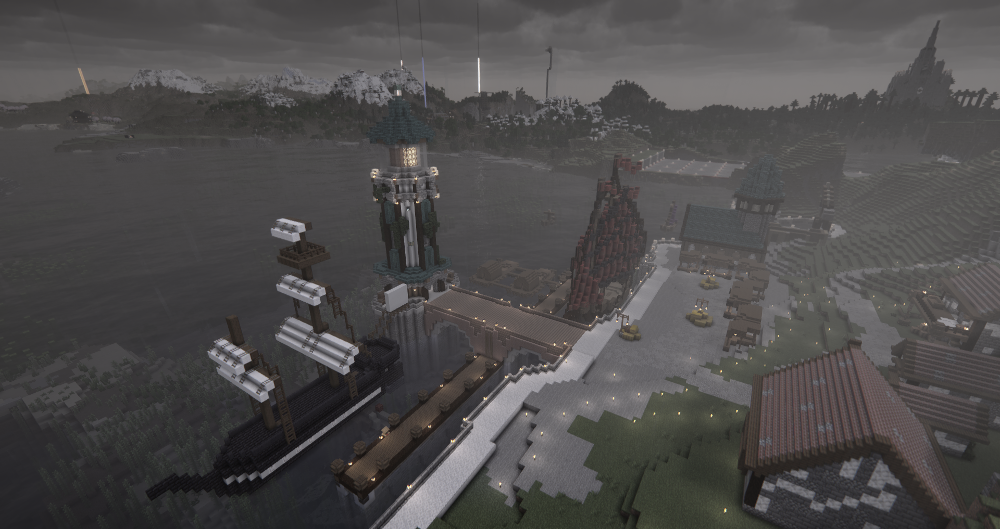<figcaption>
Судна игроков стоящие в порту спавна
</figcaption></figure>

1-е место — <mark style="color:$tint;">**Creator\_MoD\_**</mark>&#x20;

2-е место — <mark style="color:$tint;">**KILL\_AND\_LIVE**</mark>&#x20;

3-е место — <mark style="color:$tint;">**Cultyapa**</mark>&#x20;

4-е место — <mark style="color:$tint;">**Kapibarov**</mark>

### Испытание «Меч в голове <mark style="color:$tint;">**ElizarovS**</mark>»

<mark style="color:blue;">1 марта 2026 года</mark> стартовал забавный ПВП-ивент от администрации. Игрок <mark style="color:$tint;">**ElizarovS**</mark> получил редкий артефакт «Гигантский меч», торчащий прямо из его головы. В течение 4 дней любой участник сервера мог попытаться убить <mark style="color:$tint;">**ElizarovS**</mark> в честном бою и забрать артефакт себе. Несмотря на несколько ожесточённых стычек с охотниками, <mark style="color:$tint;">**ElizarovS**</mark> умело давал отпор нападавшим и избегал боёв, в которых не видел для себя верной победы. <mark style="color:blue;">5 марта</mark> он официально получил меч как заслуженную награду за успешную оборону.

<figure>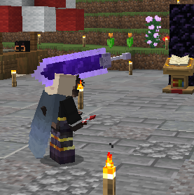<figcaption></figcaption></figure>

### Охота за головами

Игрок <mark style="color:$tint;">**vatyaoo**</mark> провела весёлый мини-квест на спавне <mark style="color:blue;">7 марта 2026 года</mark>. Игрокам требовалось отыскать 10 спрятанных декоративных голов vatyaoo на всех трёх ярусах спавна, у лавок и порта.

### Праздник в библиотеке «Просто Фокси»

<mark style="color:blue;">9 марта 2026 года</mark> в 15:00 библиотекарь <mark style="color:$tint;">**Cultyapa**</mark> при поддержке <mark style="color:$tint;">**Kapibarov**</mark> устроил масштабное и весёлое празднование в честь открытия новой большой библиотеки к востоку от спавна. Игроки лакомились закусками, пили кастомные напитки, приносили свою музыку на пластинках, а в финале читали лучшие рукописи и торжественно принимали выдающихся авторов в почётный ранг «Хранителей знаний».

<figure><figcaption>
<mark style="color:$tint;"><strong>Cultyapa</strong></mark> читает рукописи игроков
</figcaption></figure>

### Технический квест «Музыкальный шифр»

Один из самых сложных технических интерактивов сезона, организованный игроком <mark style="color:$tint;">**miniking1000**</mark>. Ивент стартовал 26 марта 2026 года. Организатор склеил две независимые аудиозаписи в один искажённый файл SPOILER\_audio.mp3 нестандартным способом, из-за чего итоговый трек звучал как хаотичный шум. Задача участников заключалась в том, чтобы с помощью кода разобрать файл обратно на два оригинальных трека. Единственным, кто полностью разгадал шифр и извлёк скрытые файлы, стал <mark style="color:$tint;">**Rory\_Williams**</mark>. Проявив железное упорство, он прошёл все этапы и получил в награду ценный артефакт.

### Безумие клоунов

&#x20;Игрок <mark style="color:$tint;">**Lionchik**</mark> провёл забавный ивент <mark style="color:blue;">1 апреля 2026 года</mark>, состоявший из двух частей:

Он спрятал на спавне клоунов, которых игрокам предстояло уничтожить, чтобы найти ценные предметы, украденные ими у <mark style="color:$tint;">**Lionchik**</mark>.

<figure>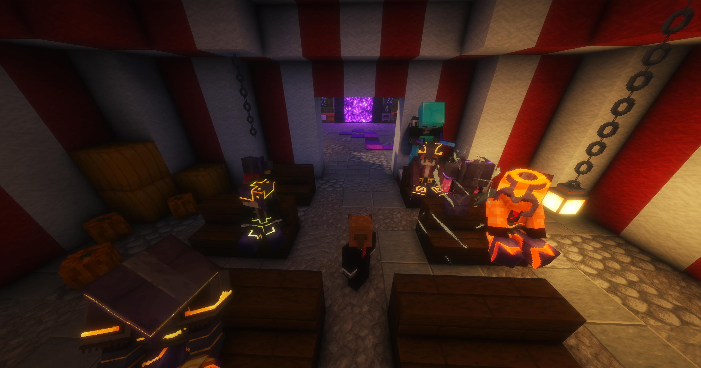<figcaption>
Игроки собравшиеся в шатре
</figcaption></figure>

Затем игроки должны были вернуться с предметами в шатёр, где организатор рассказывал об этих вещах и выдавал награду. В конце игроки рассказывали анекдоты, и лучший получил приз.

<figure>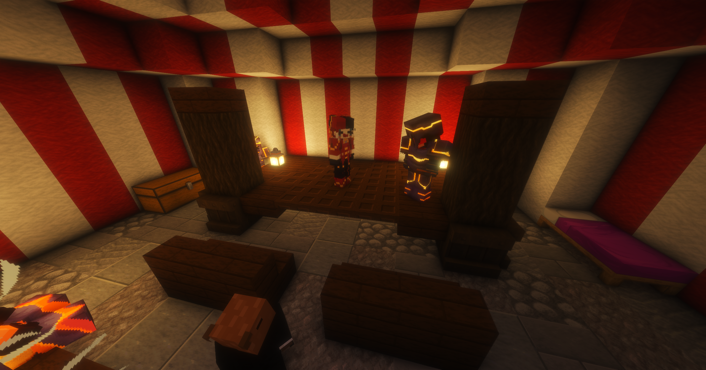<figcaption>
<mark style="color:$tint;"><strong>Creator_MoD_</strong></mark>  рассказывает анекдот
</figcaption></figure>

Ивент вышел специфичным, но запомнился как отличный дебют игрока <mark style="color:$tint;">**Lionchik**</mark> на сервере.

### «Кто-то из могилы»

<mark style="color:blue;">6 апреля 2026 года</mark> игрок <mark style="color:$tint;">**Lionchik**</mark> запустил на территории старого заброшенного кладбища с особняком смотрителя регулярный РП-хоррор ивент. Игроки оказывались заперты на кладбище, где каждую ночь на них нападал коварный восставший мертвец (один из игроков, получивший роль нежити). Задача выживших — изучить архивные сведения в особняке, выяснить слабости покойника (боязнь соли, святой воды или колокола) и провести обряд экзорцизма, положив голову убитого товарища на нужную могилу. Нежити требовалось незаметно убивать игроков мечом, совершать обязательные ритуальные действия (менять картины, оставлять кровавые редстоун-следы, ломать пустые надгробия) и оповещать о начале охоты звуком рога.&#x20;

<figure>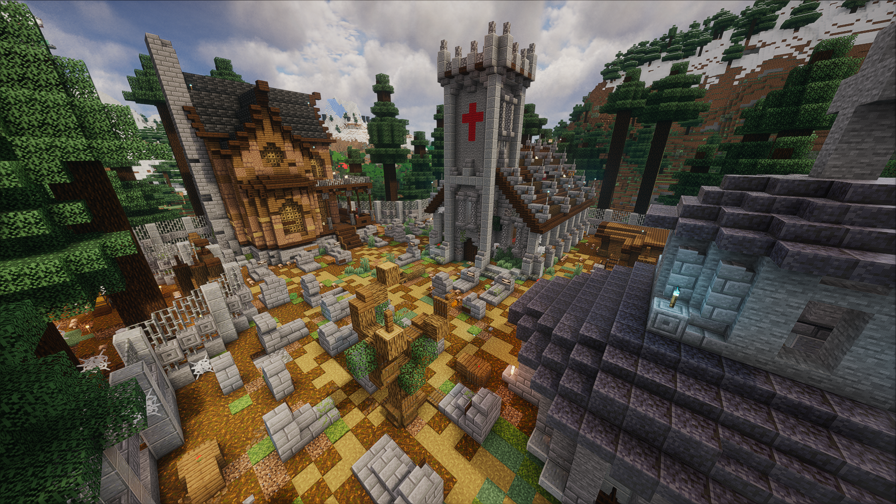<figcaption>
Место проведения ивента
</figcaption></figure>

<mark style="color:blue;">13 апреля 2026 года</mark> ивент сильно переработали: раунды ограничили 20 минутами, расширили локацию и сняли лимит на количество участников.

<figure>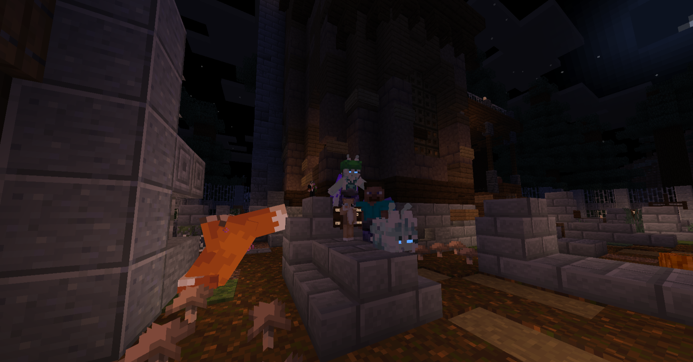<figcaption>
Игроки развлекаются после ивента
</figcaption></figure>

### Шоу «Своя игра»

В здании додзё Империи Энрин, <mark style="color:blue;">18 апреля 2026 года</mark> в 17:00 по МСК игроки <mark style="color:$tint;">**I\_valentain\_I**</mark> и <mark style="color:$tint;">**PURRCHIN**</mark> провели интеллектуальное шоу «Своя игра» на знание Minecraft. Викторина шла по классическим правилам: с жеребьёвкой, выбором категорий, кнопками на скорость и вычетом баллов за неверные ответы. Вся координация и обсуждения велись в общем Discord-канале. По итогам трёх игр победили <mark style="color:$tint;">**Aviator**</mark>, <mark style="color:$tint;">**\_Foxya\_**</mark> и <mark style="color:$tint;">**miniking1000**</mark>, получившие шалкеры с ценными призами и флаконы душ.

<figure><figcaption>
Процесс игры
</figcaption></figure>

### Экстренный аукцион

<mark style="color:blue;">3 мая 2026 года</mark> в 18:00 по МСК прошёл аукцион вещей забаненных игроков и редчайших артефактов — более масштабный, чем ранее проведенный 25 апреля. Все ставки принимались в алмазных блоках. Главный азарт заключался в том, что лоты оставались засекреченными, а игрокам давались лишь небольшие подсказки содержимого этого лота. Все артефакты, выкупленные на аукционе, гарантированно переносились во владение игроков в следующем сезоне. Мероприятие прошло на сцене, которую Совет Спавна построил в тот же день возле ристалища.

<figure>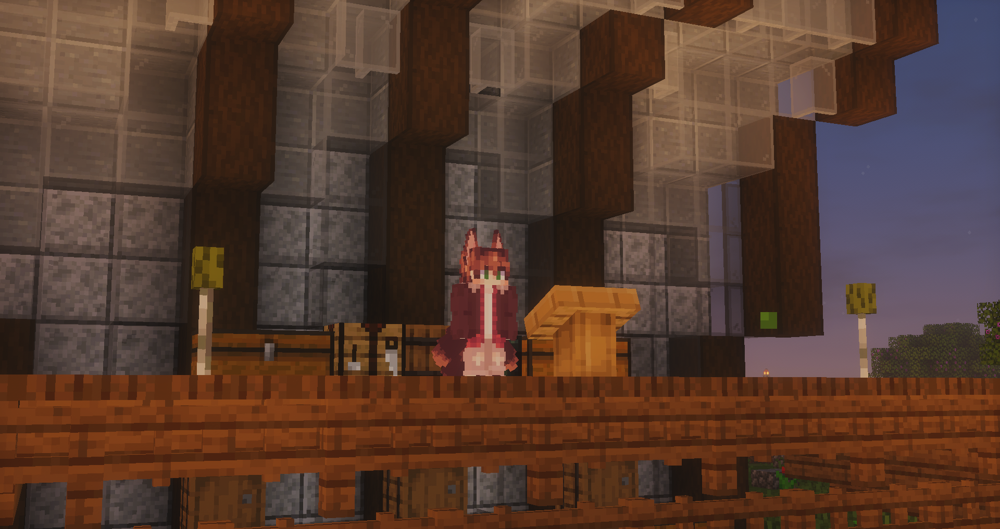<figcaption></figcaption></figure>

<figure>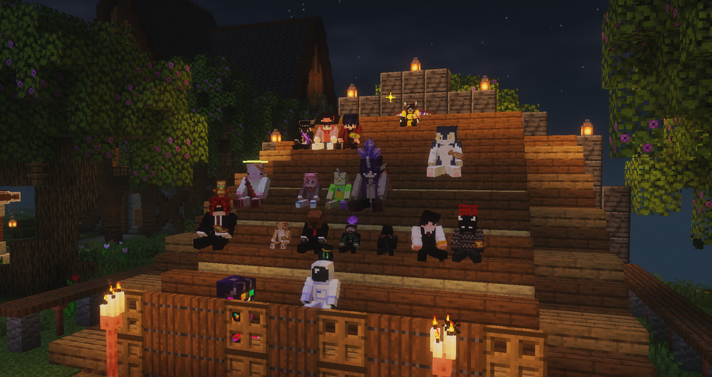<figcaption>
Игроки пришедшие на аукцион
</figcaption></figure>

### Убийство босса Uwka

<mark style="color:blue;">10 мая 2026 года</mark> в Краю прошёл мини-ивент. Администратор <mark style="color:$tint;">**Uwka**</mark> превратилась в мощного рейд-босса со сверхвысокими характеристиками: 1024 ХП, регенерация, меч с колоссальным уроном и дальностью атаки в 64 блока. На время ивента включили сохранение инвентаря, а игрокам строго запретили использовать булаву и сбрасывать босса в бездну. Финальный удар боссу нанёс <mark style="color:$tint;">**ElizarovS**</mark>, получивший в награду ценный артефакт.

<figure>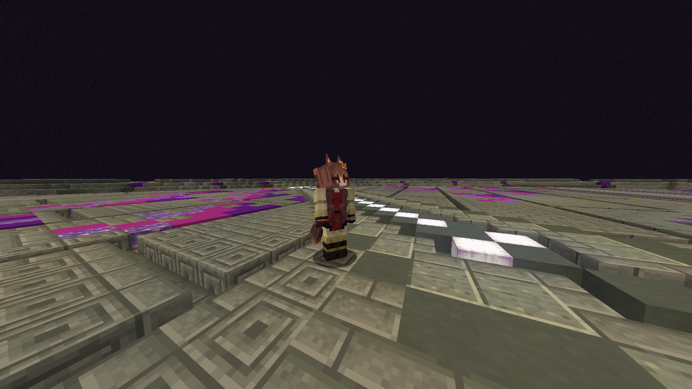<figcaption>
Рейд-босс <mark style="color:$tint;"><strong>Uwka</strong></mark> в ожидании своих противников
</figcaption></figure>

### Рыцарский турнир

<mark style="color:blue;">16 мая 2026 года</mark> на ристалище спавна администрация провела зрелищный «Рыцарский турнир». Лучшие воины сервера сошлись в честных ПВП-дуэлях, сражаясь за ценную награду. Победителем стал <mark style="color:$tint;">**Kapibarov**</mark>, получивший в награду редкий артефакт.

<figure>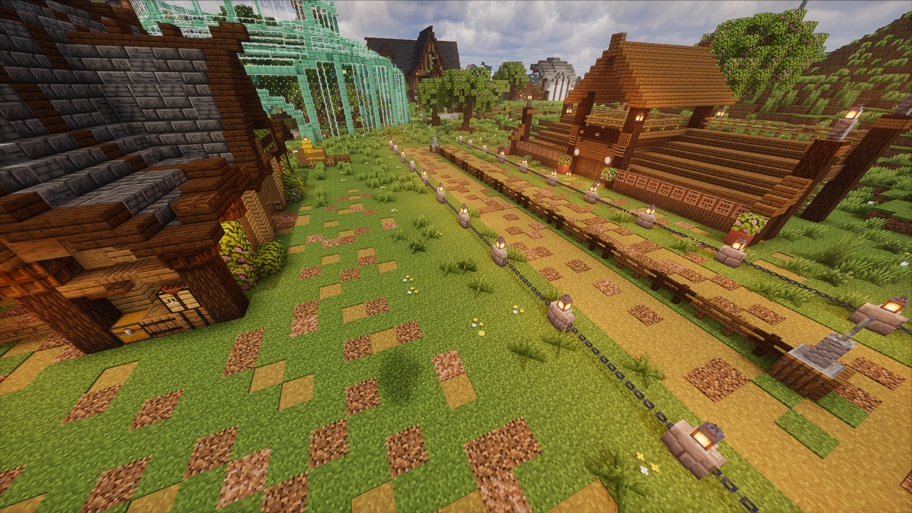<figcaption>
Вид на ристалище и конюшню
</figcaption></figure>

### Охота за «Тайными сокровищами»

Адмнистратор <mark style="color:$tint;">**\_Foxya\_**</mark>  провёл мини-ивент <mark style="color:blue;">17 мая 2026 года</mark>: он выложил в канал скриншоты четырёх локаций на сервере, где были спрятаны мощные артефакты в виде частей брони. Каждый игрок мог забрать строго одну вещь. Игрокам пришлось изрядно побегать по серверу, пользуясь картой и логикой, чтобы первыми найти заветный артефакт.

<figure>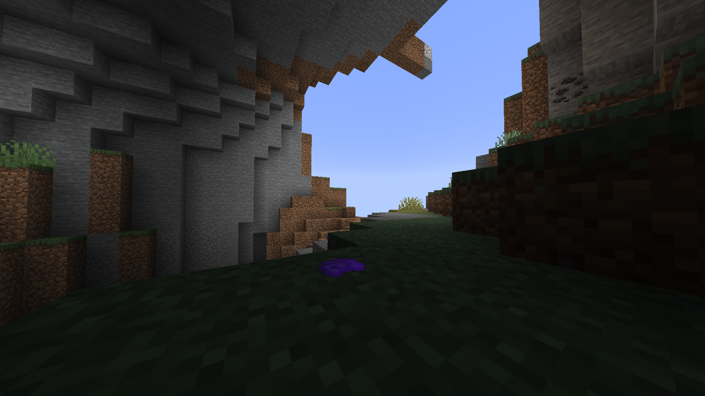<figcaption>
Один из скриншотов подсказок
</figcaption></figure>

### Самый сильный шизик

<mark style="color:blue;">В конце мая,</mark> в только что построенном санатории Д.У.Р.К.А. прошёл скрытный ПВП-ивент от <mark style="color:$tint;">**Lionchik**</mark>. Каждому игроку выдавали заточку и карточку с именем цели, которую нужно было незаметно ликвидировать без свидетелей, забирая карточку убитого для с именем следующей цели.

<figure><figcaption>
Вид на Д.У.Р.К.А.
</figcaption></figure>

### Охота на уточек

Игрок <mark style="color:$tint;">**PARAVAZIVAL**</mark> <mark style="color:blue;">2 июня 2026 года</mark> устроил милый поисковый квест. По всему серверу были спрятаны 10 больших стеклянных уточек с подарками. Нашедшему требовалось сделать селфи на фоне уточки и разбить стекло, чтобы получить приз.

<figure>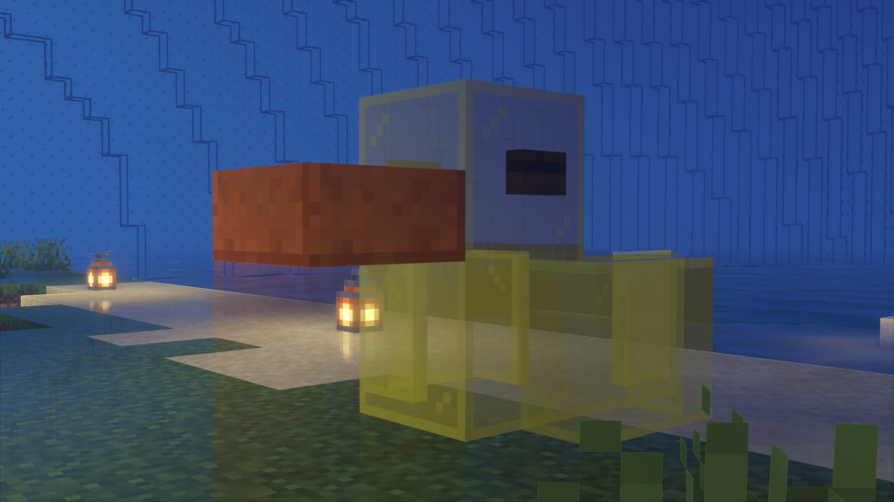<figcaption>
Одна из уточек
</figcaption></figure>

### «Бункер»

<mark style="color:blue;">14 июня 2026 года</mark> в 16:00 в специализированном убежище ОБРОМа основатели <mark style="color:$tint;">**Kapibarov**</mark> и <mark style="color:$tint;">**Lionchik**</mark> провели масштабный ролевой интерактив, полностью воссоздающий настольную игру «Бункер». Метеориты падали без остановки, и игрокам пришлось жарко дискутировать, доказывая свою полезность, чтобы попасть в спасительный бункер.

Попавшие в бункер игроки: <mark style="color:$tint;">d</mark><mark style="color:$tint;">**octor\_yosh, Narshon, lamEscuro, Lionchik.**</mark>

<figure>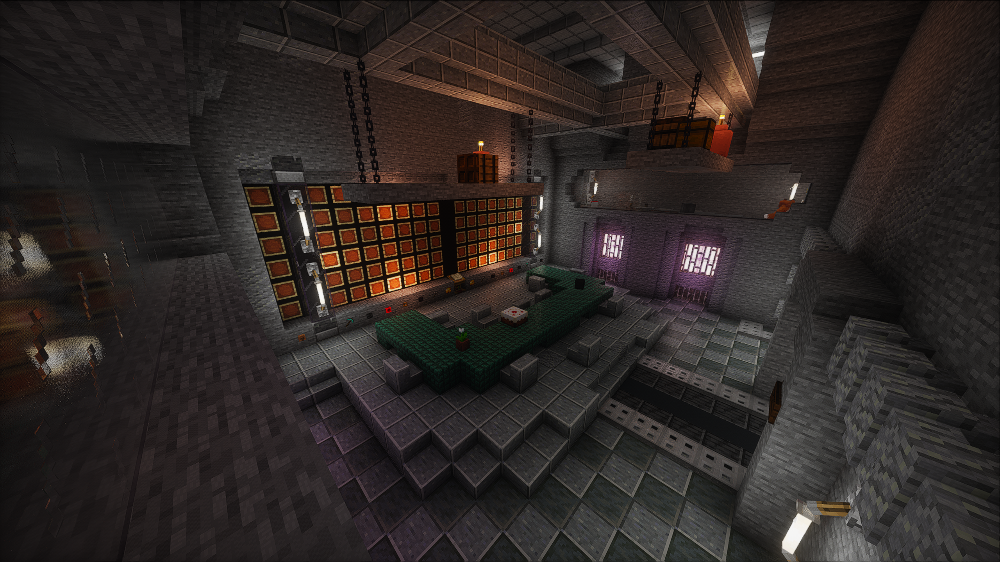<figcaption>
Место проведения ивента
</figcaption></figure>

### Прощальный снимок сезона

На центральной площади у здания Совета спавна, <mark style="color:blue;">8 июля 2026 года</mark> в 17:00 игроки собрались на финальный ламповый мини-ивент организованный игроком <mark style="color:$tint;">**Kapibarov**</mark>. Все участники сделали большое совместное фото на фоне построенного города, после чего отправились отмечать успешное окончание 8 сезона.

<figure>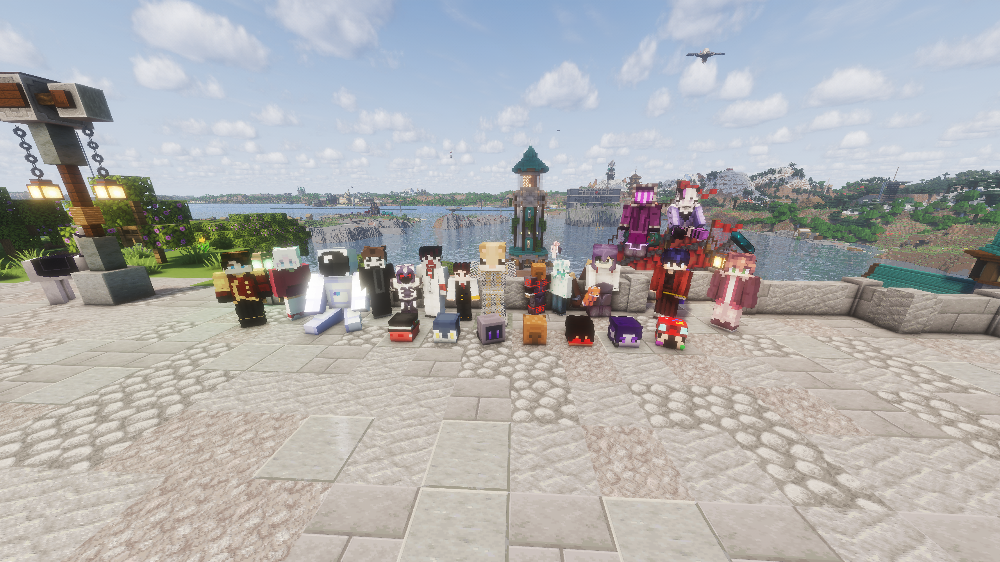<figcaption>
Последняя крупная встреча игроков перед окончанием сезона
</figcaption></figure>

[^1]: Оружие, броня, а также другие предметы с уникальными свойствами или зачарованиями.

[^2]: Зачарование для элитр, позволяющее парить над лавой, магмой или огнём, взамен на прочность крыльев.
