# Алхимия

Для начала вам нужно прописать особую команду и открыть меню алхимии:\
<mark style="color:blue;">**/алхимия**</mark>

### **Как этим пользоваться?**&#x20;

Шаг 1 - Сварите обычные зелья, без них никуда&#x20;

Шаг 2 - Поместите зелья в один или несколько нижних слотов - эти зелья будут получать эффекты&#x20;

Шаг 3 - Поместите зелье (или другой предмет) в слот ингредиента - это предмет, который будет добавлен к другим зельям.

* Поместим наверх зелье, оно равномерно распределиться по слотам ниже
* Поместив краситель зелья внизу станут немного красивее
* Поместив пчелиные соты зелья внизу больше нельзя будет покрасить


При использовании пчелиных сот или красителей, зелья потеряют немного чистоты.


&#x20;Шаг 4 - Если есть - поместить в слот топлива "Катализатор"&#x20;

&#x20;Шаг 5 - Наполнить алхимию опытом - получайте опыт, и его часть будет уходить в алхимию. Когда опыта будет достаточно - алхимия завершиться и вы получите готовые зелья!

### Механика повышения уровня зелья

При смешивании зелий игра складывает их **время**, а не уровни.

Если пул превышает лимит (10 мин), игра повышает уровень готового зелья, но **делит его время на 2**. Это повторяется, пока время не «влезет» в лимит.

При расчете зелье **2-го уровня** дает в **2 раза** больше минут, а **3-й уровень** — в **4 раза** больше своего видимого времени.Минуты всех зелий складываются в общий пул.

**Главный совет игрокам:** Выгоднее всего изначально варить долгие зелья **1-го уровня**


В одном зелье можно совместить максимум 5 эффектов!


<figure><figcaption></figcaption></figure>

### <mark style="color:$primary;">**Про катализаторы**</mark>&#x20;

Катализатор - специальные предметы. Они повышают или понижают некоторые характеристики алхимии, такие как:&#x20;

<mark style="color:$success;">**Ёмкость**</mark> - Сколько опыта может храниться внутри алхимии (изначально 800 едениц)&#x20;

<mark style="color:violet;">**Чистота**</mark> - Сколько % зелья сохраниться после алхимии (изначально после крафта будет сохранено 95% зелья)

<mark style="color:cyan;">**Использование**</mark> - Сколько времени занимает алхимия, и сколько опыта она потребляет (изначально 2.0)

### <mark style="color:violet;">**Катализаторы ориентированные на чистоту**</mark>

#### &#x20;                                                 **Чистый золотой блок**

<figure>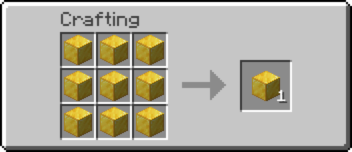<figcaption></figcaption></figure>

<mark style="color:$success;">**Ёмкость**</mark>**&#x20;- 800**

<mark style="color:violet;">**Чистота**</mark>**&#x20;- 95.5%**

 <mark style="color:cyan;">**Использование**</mark>**&#x20;- 2**

#### &#xD;                                            **Чистейший золотой блок**

<figure><figcaption>
Золотые блоки в крафте это чистые золотые блоки
</figcaption></figure>

<mark style="color:$success;">**Ёмкость**</mark>**&#x20;- 850**

<mark style="color:violet;">**Чистота**</mark>**&#x20;- 97.5%**

 <mark style="color:cyan;">**Использование**</mark>**&#x20;- 1.95**

#### &#x20;                                                        **Чистая оправа**

<figure>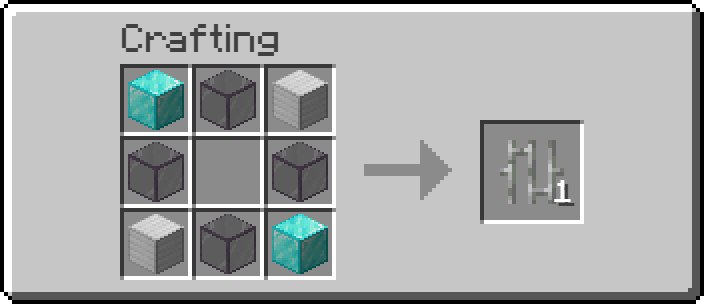<figcaption></figcaption></figure>

<mark style="color:$success;">**Ёмкость**</mark>**&#x20;- 1000**

<mark style="color:violet;">**Чистота**</mark>**&#x20;- 95.5%**

 <mark style="color:cyan;">**Использование**</mark>**&#x20;- 2.15**

#### &#x20;                                            **Недопадшая звезда**

<figure>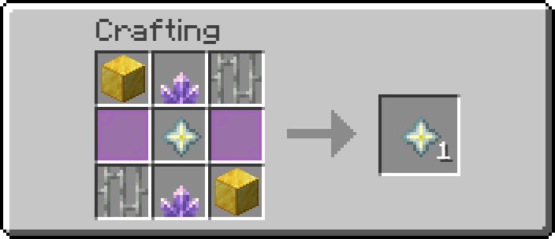<figcaption>
Золотые блоки в крафте это чистейшие золотые блоки Железные прутья это Чистые оправы
</figcaption></figure>

<mark style="color:$success;">**Ёмкость**</mark>**&#x20;- 1200**

<mark style="color:violet;">**Чистота**</mark>**&#x20;- 98.5%**

 <mark style="color:cyan;">**Использование**</mark>**&#x20;- 2.05**

### <mark style="color:$success;">**Катализаторы ориентированные на ёмкость**</mark>

#### &#x20;                                           **Топливный бак**

<figure>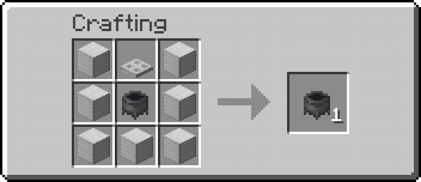<figcaption></figcaption></figure>

<mark style="color:$success;">**Ёмкость**</mark>**&#x20;- 1800**

<mark style="color:violet;">**Чистота**</mark>**&#x20;- 91.5%**

 <mark style="color:cyan;">**Использование**</mark>**&#x20;- 2**

#### &#x20;                                  **Большой топливный бак**

<figure>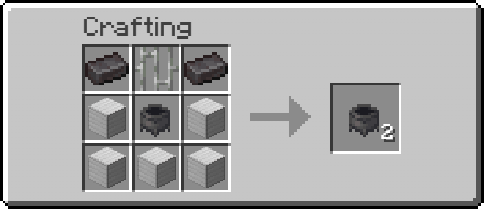<figcaption>
Железные прутья это Чистые оправы Котел это Топливный бак
</figcaption></figure>

<mark style="color:$success;">**Ёмкость**</mark>**&#x20;- 3500**

<mark style="color:violet;">**Чистота**</mark>**&#x20;- 92.5%**

 <mark style="color:cyan;">**Использование**</mark>**&#x20;- 1.95**

#### &#x20;                            **Межпространственный сундук**

<figure>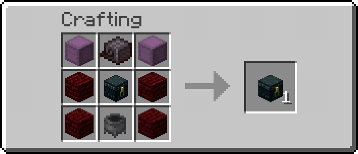<figcaption>
Незеритовая броня наутилуса это Фильтр Котел это Большой топливный бак
</figcaption></figure>

<mark style="color:$success;">**Ёмкость**</mark>**&#x20;- 5500**

<mark style="color:violet;">**Чистота**</mark>**&#x20;- 92.5%**

 <mark style="color:cyan;">**Использование**</mark>**&#x20;- 1.8**

### <mark style="color:cyan;">**Катализаторы ориентированные на**</mark> <mark style="color:cyan;"></mark><mark style="color:cyan;">эффективность</mark>

#### &#x20;                                               **Проточное ядро**

<figure>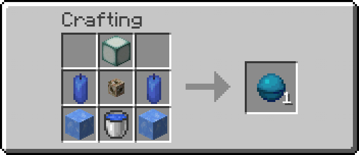<figcaption></figcaption></figure>

<mark style="color:$success;">**Ёмкость**</mark>**&#x20;- 610**

<mark style="color:violet;">**Чистота**</mark>**&#x20;- 95.5%**

 <mark style="color:cyan;">**Использование**</mark>**&#x20;- 1.7** &#x20;

#### &#x20;                                          **Коралловая рыба**

<figure>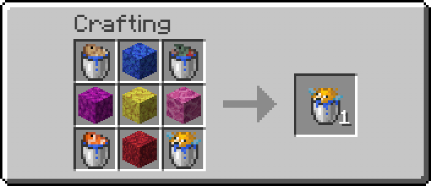<figcaption></figcaption></figure>

<mark style="color:$success;">**Ёмкость**</mark>**&#x20;- 800**

<mark style="color:violet;">**Чистота**</mark>**&#x20;- 94.75%**

 <mark style="color:cyan;">**Использование**</mark>**&#x20;- 1.75**

#### &#x20;                                             **Энзимное яйцо**

<figure>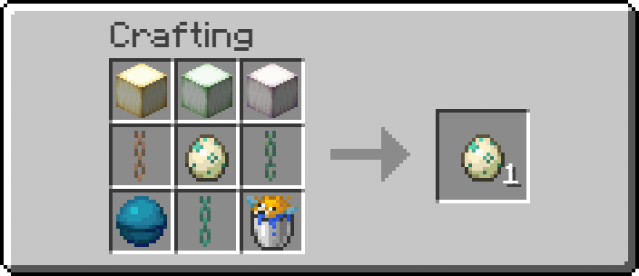<figcaption>
Сердце моря это Проточное ядро Рыба в ведре это Коралловая раба Некоторые медные цепи завощены
</figcaption></figure>

<mark style="color:$success;">**Ёмкость**</mark>**&#x20;- 900**

<mark style="color:violet;">**Чистота**</mark>**&#x20;- 95.5%**

 <mark style="color:cyan;">**Использование**</mark>**&#x20;- 1.35**

#### &#x20;                                                      **Фильтр**

<figure>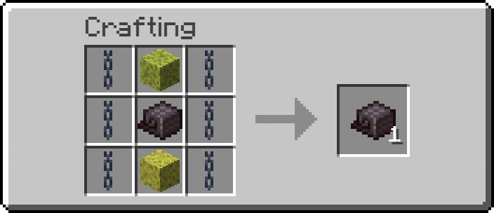<figcaption></figcaption></figure>

<mark style="color:$success;">**Ёмкость**</mark>**&#x20;- 900**

<mark style="color:violet;">**Чистота**</mark>**&#x20;- 96%**

 <mark style="color:cyan;">**Использование**</mark>**&#x20;- 1.75**

#### &#x20;                                           **Скоростной фильтр**

<figure>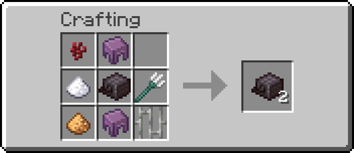<figcaption>
Железные прутья это Чистая оправа Незеритовая наутилусовая броня это Фильтр
</figcaption></figure>

<mark style="color:$success;">**Ёмкость**</mark>**&#x20;- 1100**

<mark style="color:violet;">**Чистота**</mark>**&#x20;- 95%**

 <mark style="color:cyan;">**Использование**</mark>**&#x20;- 1.55**
