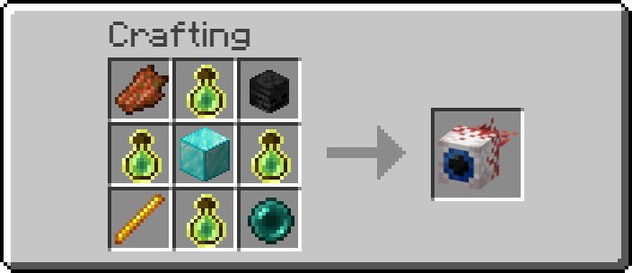

# Боссы

С помощью ресурсов вы можете создать предмет, который при его использовании исчезнет, взамен превратив случайного стандартного враждебного моба в босса.

<figure><figcaption>
<em>Крафт предмета, призывающего босса</em>
</figcaption></figure>

* Боссы периодически выпускают синие головы визера, так что не рекомендуется призывать их и сражаться возле построек.

### Условия убийства

* Книга гарантированно выпадает только при <mark style="color:$primary;">**прямом убийстве игроком**</mark>
* Если босс погибает от сторонних факторов окружающей среды или от эффекта огня или ядра от вашего снаряжения, книга <mark style="color:$primary;">**не выпадает**</mark>

Текущий шанс выпадения книги составляет <mark style="color:$primary;">100%</mark>, но её тип строго привязан к редкости убитого босса. Зачарование [_Освещенность_](unikalnye-zacharovaniya.md#osveshyonnost) может выпасть только с самого лучшего босса, тогда как например [_Тяжёлая стрела_](unikalnye-zacharovaniya.md#tyazhyolaya-strela) может выпасть только с самого слабого.

### Редкости боссов

* _<mark style="color:$success;">**Зелёный**</mark>_ — Необычный
* _<mark style="color:blue;">**Синий**</mark>_ — Редкий
* _<mark style="color:violet;">**Фиолетовый**</mark>_ — Эпический
* _<mark style="color:$tint;">**Оранжевый**</mark>_ — Легендарный
* _<mark style="color:$danger;">**Красный**</mark>_ — Артефактный

### Влияние зачарования Добыча

Уровень выпадающей книги масштабируется и зависит от уровня эффекта.\
Зачарование Добыча учитывается <mark style="color:$primary;">**только при убийстве мечом**</mark>, при убийстве из лука или арбалета бонус к добыче не применяется.

***
